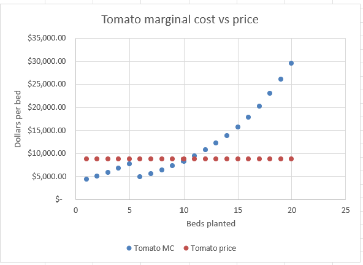
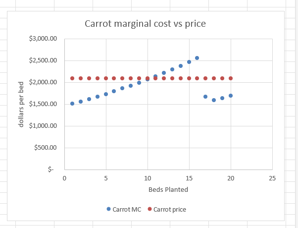

# Perfect Competition: Analysis

## 1. Where does the money crop stop, and why there?

Tomato profit increases steadily through Bed 10, reaching a maximum of $26,172.77 (H14) , before declining at Bed 11 to $25,582.06 (H15). This decline is driven by compounding labor costs, which begin to outweigh the additional revenue generated by expanding production.  At Bed 10, labor costs total $53,027.23 (D14), and total costs are $61,827.23 (F14). At Bed 11, labor costs increase to $61,537.94 (D15), an increase of $8,510.71, or approximately 16.1%. Total costs rise to $71,217.94 (F15), an increase of $9,390.71. As you can see in Figure 1 blue MC line cross the red price line slightly after bed 10 which indicates there is no longer profit made.

At bed 10 MC $8248.59 (I14) still makes $551.41 profit considering it brings in $8,800 to plant.  At 11 beds MC $9,390.72 (I15) with the same revenue of $8,800, it cost the farm by reducing overall profit by $590.71. Expanding beyond 10 beds would be financially inefficient under the current cost structure because the additional production reduces, rather than increases, total profit.

I seriously considered stop planting at bed 8 because up to bed 8 is where the profit grows with maximum numbers. Profit gain from bed 6 to 7 is $3,214.29 (H11-H10) and from 7 to 8 is $2,439.23(H12-H11). But from bed 9 to 10 is barely making profit $551.41 (H14-H13) and at bed 11 is losing profit.  Is it worth planting bed 9 and 10?  But my answer is yes, to bed 9 and 10 because adding profit and paying toward fixed expense is more important than the profit margin.

## 2. Which constraints bind, and what relaxing one is worth

The maximum bed constraints are binding, limiting carrot production to 20 beds and mesclun production to 30 beds. Carrots MC at bed 20 is $1,688.95 (Q24) and be 21 is at $1,741.51 (Q25) with each bed bring in $2,094 revenue add profit to the overall farm production. Mesclun at bed 30 with MC $2420.10 (Y34) with it's revenue of $2,700 still profitable.  Since tomato production yields maximum profit at 10 beds, four beds remain unused under the current constraints. Rather than leaving this capacity idle, the farm could improve overall profitability by relaxing the maximum bed constraint for carrots. The shadow price for carrots at the 21-bed level is $352.50 (B19), compared with $246.48 for mesclun (B20). Therefore, carrots offer a greater marginal return on additional bed capacity by one since that is the only solid data on hand.

The labor cap is also binding, at 6,480 hours; however, according to the optimization analysis only 5,277.22 hours are used which is under the cap.

## 3. Does any marginal cost curve ever fall, and what would explain it?

Tomato marginal cost increases steadily through Bed 5, reaching $7,660.86 (I9), before dropping to $4,906.28 at Bed 6 (I10). This decrease occurs because the farmer’s 720 available labor hours are initially valued at $34.72 per hour. Beginning at Bed 6, only the temporary labor at a lower wage of $17.36 per hour is calculated, reducing the marginal cost of additional production.  After Bed 6, marginal cost begins to rise again as production expands with it's 10.00%  diminishing returns per bed due to compound labor cost. At Bed 6, it needs additional 232 hours of labor from bed 5 (C10-C9). Bed 10 requires additional 424 hours (C14-C13) additional hours from Bed 9 because of 10.00% compounding labor cost.  As indicated in Figure 1, the blue line at bed 6 disappears because the farmers labor hours of 720 is used up and the lower rate temporary worker labor gets put in.  Carrots at bed 16 (Q20) the MC is higher than the revenue of $2094 but it falls to $1670.90 at bed 17 (Q21) as you can see in Figure 2.

## 4. Would each crop make money on its own, and does that matter?

Carrots at $3,511.08 profit at bed 20 (Q24) and mesclun at $8,077.81 (X34) cannot by themselves cover the fix cost of $20,000 fixed cost the farm has to pay whether the plot is used or not.  However, tomato at bed 10 at profit of $26,172.77 (H14) can alone cover the $20,000, but it alone does not bring maximum profit for the farm $42,761.66 optimum (B13).  It is price against marginal cost settles how many beds get planted for each crop.  

## Against my Stage 1 hypothesis

Now with the complete analysis 
I considered lowering the tomatoes bed to 11 because the whole point is to make more profit instead of using maximum allotted plots. However, I will stay with tomatoes 14 beds because my calculations after 11 or 12 beds returns will be less or marginal, but I'm not certain it will be more beneficial than leaving 3 beds empty for the season.  I am willing to take the risk of 3 extra beds of tomatoes if it’s at least marginally profitable instead of eating up my profit.  It will be interesting to see if my prediction is correct or completely off that I should have planted more tomatoes.

